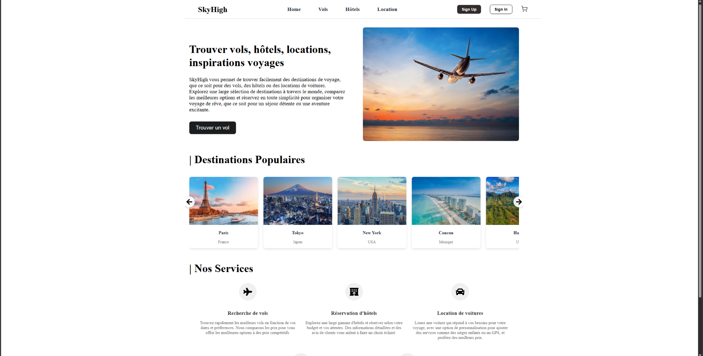
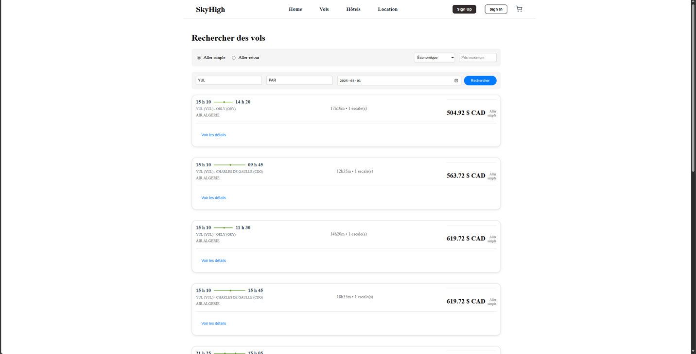
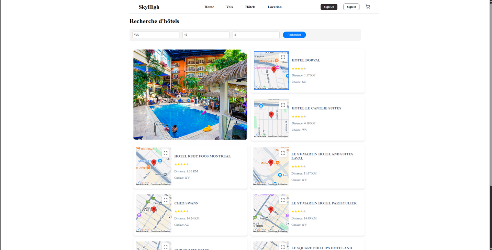
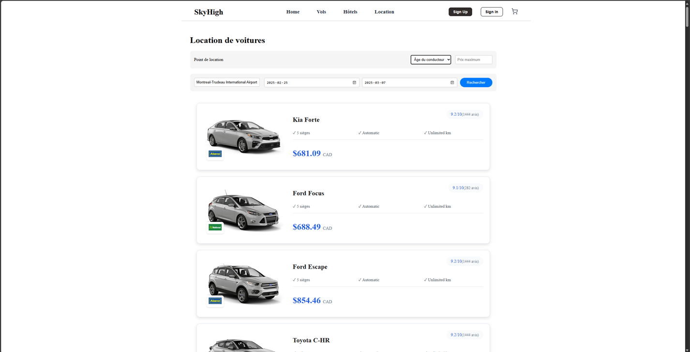
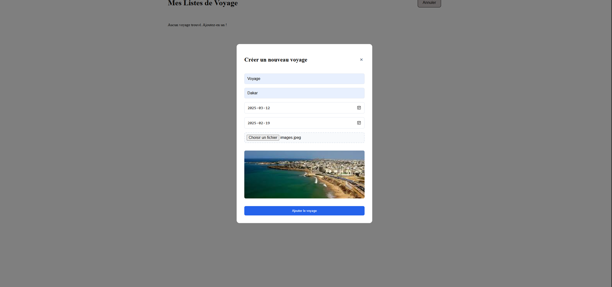
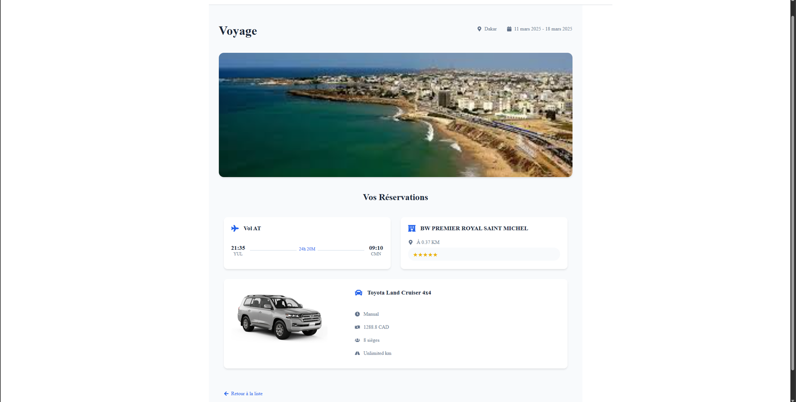

# 🌍 Travel Booking App

**Travel Booking App** est une application de réservation de voyages tout-en-un permettant aux utilisateurs de réserver des **vols**, **hôtels** et **voitures**, avec une interface moderne et responsive.  

---

## ✈️ Fonctionnalités principales

- 🔐 Authentification sécurisée avec Firebase
- 📆 Réservation de vols, hôtels et voitures
- 🗺️ Intégration d’une carte interactive (Google Maps API / Leaflet)
- 💾 Sauvegarde des préférences utilisateur
- 📱 Interface responsive (mobile & desktop)

---

## 🛠️ Technologies utilisées

- ⚛️ **React** (Vite)
- 🔥 **Firebase** (Auth, Firestore, Hosting)
- 🧠 **JavaScript / JSX**
- 🎨 **CSS**
- 🌐 **Google Maps API** ou **Leaflet**

---

## 📅 Informations

- 🗓️ **Date de finalisation** : mai 2025  
- 🚀 **Ajout au portfolio GitHub** : juillet 2025  
- 👨‍💻 **Développé par** : Sofiane Ferhaoui

---

## 📸 Aperçu de l'application

### 🏠 Accueil

### ✈️ Recherche de vols

### 🏨 Recherche d’hôtels

### 🚗 Location de voitures

### ⭐ Liste de favoris

### 📄 Résumé du voyage

